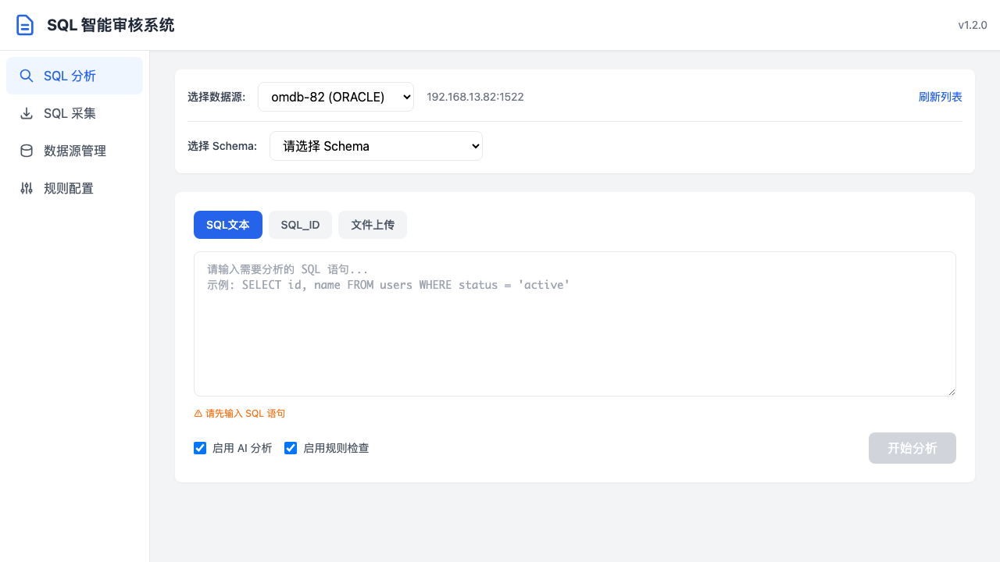
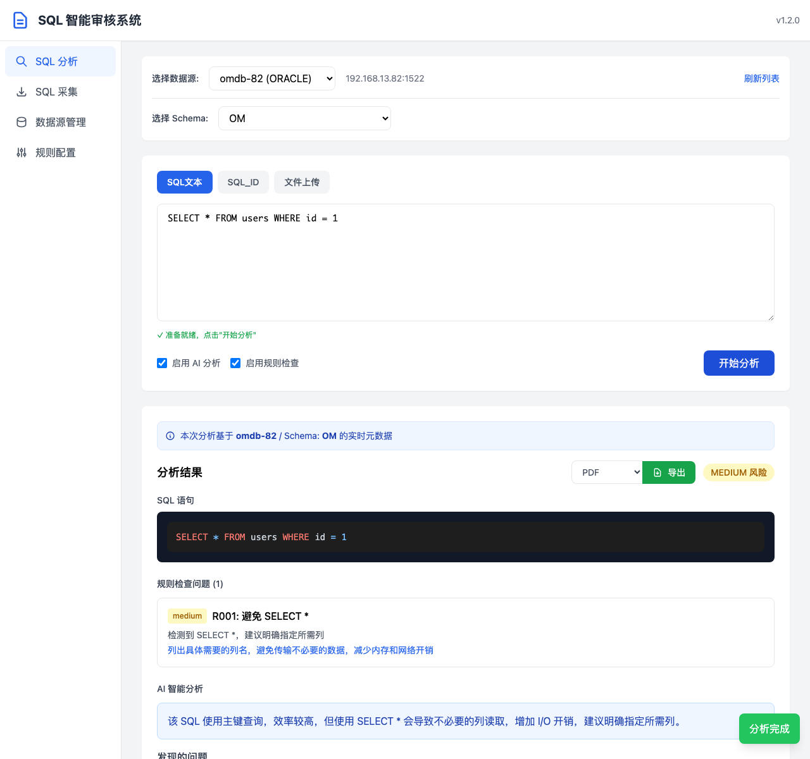
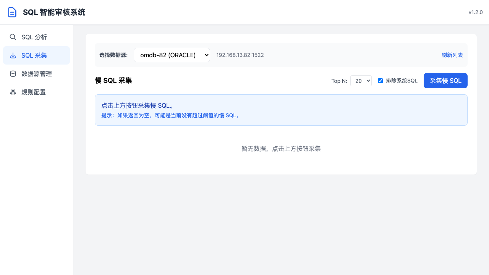
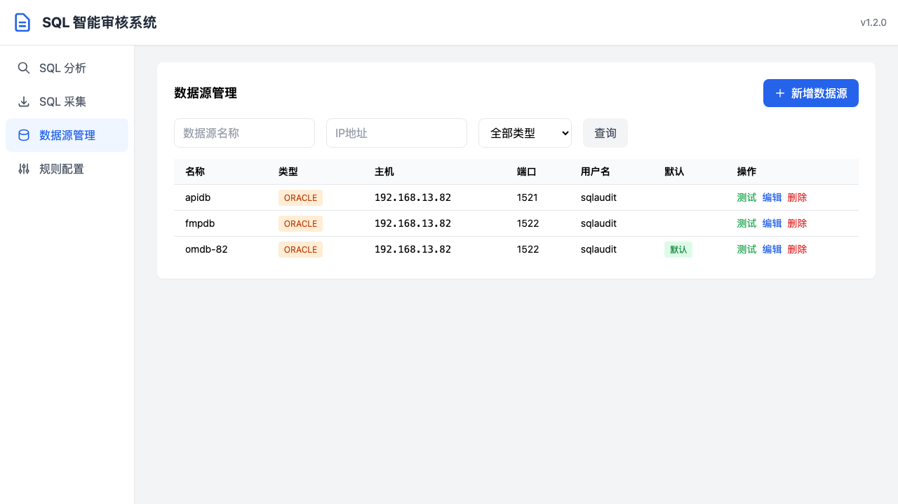
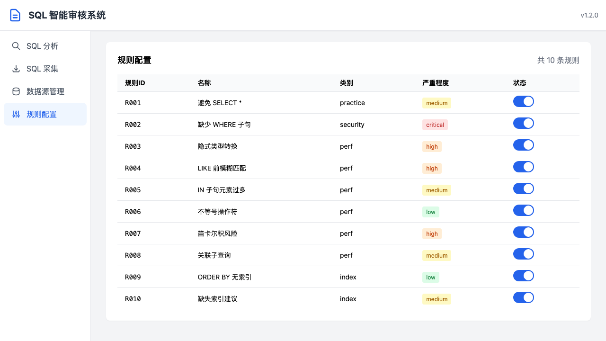

# SQL 智能审核系统 - 用户使用手册

**版本：** v1.2.0  
**日期：** 2026-05-11

---

## 目录

1. [系统简介](#1-系统简介)
2. [快速开始](#2-快速开始)
3. [功能模块](#3-功能模块)
   - 3.1 [SQL 分析](#31-sql-分析)
   - 3.2 [SQL 采集](#32-sql-采集)
   - 3.3 [数据源管理](#33-数据源管理)
   - 3.4 [规则配置](#34-规则配置)
4. [分析结果导出](#4-分析结果导出)
5. [常见问题](#5-常见问题)

---

## 1. 系统简介

SQL 智能审核系统是一款面向 Oracle 数据库的 SQL 质量分析与优化工具。系统结合**规则引擎**和**AI 大模型**对 SQL 语句进行深度分析，帮助开发者和 DBA 发现潜在的性能问题、安全风险和写法缺陷。

### 核心能力

| 能力 | 说明 |
|------|------|
| 规则引擎检查 | 10 条内置规则，涵盖性能、安全、规范等维度 |
| AI 智能分析 | 基于大语言模型的 SQL 深度分析，提供优化建议 |
| 执行计划分析 | 结合数据库真实执行计划进行诊断 |
| 元数据感知 | 基于真实表结构、索引、统计信息进行分析 |
| 多格式导出 | 支持 PDF、HTML、Markdown 三种格式导出 |
| 多数据源管理 | 支持配置多个 Oracle 数据源，灵活切换 |

---

## 2. 快速开始

### 2.1 首次使用流程

```
1. 配置数据源  →  2. 选择 Schema  →  3. 输入 SQL  →  4. 开始分析
```

### 2.2 界面概览

系统采用左侧导航 + 右侧内容区的布局：

- **顶部标题栏**：显示系统名称和版本号
- **左侧导航栏**：SQL 分析、SQL 采集、数据源管理、规则配置
- **右侧内容区**：当前功能模块的操作界面



---

## 3. 功能模块

### 3.1 SQL 分析

SQL 分析是系统的核心功能，支持三种输入方式：SQL 文本、SQL_ID、文件上传。

#### 3.1.1 使用 SQL 文本分析

**操作步骤：**

1. **选择数据源**：从下拉框中选择已配置的数据库连接
2. **选择 Schema**：选择要分析的 Schema（数据库用户）
3. **输入 SQL**：在文本框中粘贴或输入 SQL 语句
4. **配置分析选项**：
   - **启用 AI 分析**：是否调用大语言模型进行深度分析（建议开启）
   - **启用规则检查**：是否运行规则引擎进行静态检查（建议开启）
5. **点击"开始分析"**按钮


**输入校验提示：**
- 未输入 SQL 时，下方显示橙色提示 "⚠ 请先输入 SQL 语句"
- 未选择 Schema 时，显示 "⚠ 请先选择 Schema"
- 所有条件满足后，显示绿色提示 "✓ 准备就绪，点击'开始分析'"

#### 3.1.2 分析结果解读

分析完成后，页面下方会展开**分析结果卡片**，包含以下内容：



**结果卡片组成：**

| 区域 | 说明 |
|------|------|
| **元数据来源标注** | 显示本次分析使用的数据源和 Schema，基于实时元数据 |
| **风险等级** | CRITICAL / HIGH / MEDIUM / LOW，根据规则违规和 AI 发现问题综合评定 |
| **SQL 语句** | 语法高亮显示的原始 SQL |
| **规则检查问题** | 规则引擎发现的违规项，含规则 ID、严重程度、问题描述、修复建议 |
| **AI 智能分析** | 大模型生成的总体评价、发现问题、索引建议、重写建议、优化建议 |

**规则严重程度标识：**

- 🔴 **critical** — 严重，可能导致系统故障或安全问题
- 🟠 **high** — 高，明显性能隐患
- 🟡 **medium** — 中，建议优化
- 🟢 **low** — 低，轻微问题

#### 3.1.3 使用 SQL_ID 分析

适用于已存在于数据库中的 SQL：

1. 点击 **"SQL_ID"** 标签页
2. 输入 Oracle SQL_ID（如 `abc123def`）
3. 点击"开始分析"

系统会自动从数据库中获取 SQL 文本和执行计划进行分析。

#### 3.1.4 文件上传分析

支持批量上传 SQL 文件：

1. 点击 **"文件上传"** 标签页
2. 拖拽 `.sql` 或 `.txt` 文件到上传区域，或点击选择文件
3. 系统自动解析文件中的 SQL 语句并分析

---

### 3.2 SQL 采集

SQL 采集功能用于从数据库中自动抓取慢 SQL，便于批量分析。



**操作步骤：**

1. 选择数据源
2. 设置 **Top N**：采集最慢的 N 条 SQL（默认 20）
3. 勾选/取消 **排除系统 SQL**：是否过滤 Oracle 系统 SQL
4. 点击 **"采集慢 SQL"** 按钮
5. 采集完成后，列表显示慢 SQL，可逐条点击分析

> **提示：** 如果返回为空，说明当前没有超过阈值的慢 SQL。

---

### 3.3 数据源管理

数据源管理用于配置和维护数据库连接信息。



#### 3.3.1 添加数据源

1. 点击右上角 **"+ 新增数据源"** 按钮
2. 填写表单：
   - **名称**：数据源显示名称（如 `生产库-OMDB`）
   - **数据库类型**：目前支持 Oracle
   - **主机地址**：IP 或域名
   - **端口**：Oracle 端口（默认 1521）
   - **连接方式**：Service Name 或 SID
   - **服务名/SID**：对应填写
   - **用户名/密码**：数据库登录凭据
   - **描述**：可选备注
3. 点击 **"测试连接"** 验证连通性
4. 点击 **"保存"** 完成添加

#### 3.3.2 设置默认数据源

列表中点击某行数据源右侧的 **"默认"** 按钮，该数据源将成为分析时的默认选项。

#### 3.3.3 编辑/删除数据源

- **测试**：验证当前数据源连接是否正常
- **编辑**：修改数据源配置信息
- **删除**：移除数据源（需确认）

---

### 3.4 规则配置

规则配置用于查看和管理 SQL 审核规则，可启用或禁用特定规则。



#### 3.4.1 规则列表

系统内置 10 条规则：

| 规则 ID | 名称 | 类别 | 严重程度 |
|---------|------|------|----------|
| R001 | 避免 SELECT * | practice | medium |
| R002 | 缺少 WHERE 子句 | security | critical |
| R003 | 隐式类型转换 | perf | high |
| R004 | LIKE 前模糊匹配 | perf | high |
| R005 | IN 子句元素过多 | perf | medium |
| R006 | 不等号操作符 | perf | low |
| R007 | 笛卡尔积风险 | perf | high |
| R008 | 关联子查询 | perf | medium |
| R009 | ORDER BY 无索引 | index | low |
| R010 | 缺失索引建议 | index | medium |

#### 3.4.2 启用/禁用规则

点击规则右侧的开关即可启用或禁用该规则。禁用后，该规则在 SQL 分析中不再生效。

---

## 4. 分析结果导出

分析完成后，可将结果导出为多种格式，便于存档或分享。

### 4.1 导出格式

系统支持三种导出格式：

| 格式 | 扩展名 | 适用场景 |
|------|--------|----------|
| **PDF** | .pdf | 正式报告、邮件附件、存档 |
| **HTML** | .html | 浏览器查看、内部分享 |
| **Markdown** | .md | 技术文档、Wiki 集成 |

### 4.2 导出操作

1. 完成 SQL 分析，等待结果展示
2. 在分析结果卡片右上角，选择导出格式（PDF / HTML / Markdown）
3. 点击 **"导出"** 按钮
4. 浏览器自动下载报告文件

**导出内容包含：**
- 基本信息（SQL ID、类型、涉及表）
- SQL 语句（语法高亮）
- 规则检查结果（违规详情 + 修复建议）
- AI 智能分析（总体评价、发现问题、索引建议、重写建议、优化建议）
- 综合建议

---

## 5. 常见问题

### Q1: 分析时提示"请先选择 Schema"？

选择数据源后，Schema 列表会自动加载。如果下拉框为空，点击 **"刷新列表"** 按钮重新获取。

### Q2: 分析结果中 AI 智能分析为空？

可能是 LLM 服务暂时不可用或超时。系统会自动降级，仅返回规则引擎结果。可检查后端日志确认 LLM 服务状态。

### Q3: 如何部署到生产环境？

1. 配置 Docker 部署
2. 通过 **数据源管理** 页面添加生产数据库连接
3. `.env` 文件中不再需要配置默认 Oracle 连接
4. 使用 `docker run -v ./data:/app/data` 挂载数据目录，确保数据源配置持久化

### Q4: 支持 MySQL 吗？

当前版本主要支持 Oracle 数据库。MySQL 支持正在开发中，可通过数据源管理的"数据库类型"字段看到当前仅支持 ORACLE。

### Q5: 导出的 PDF 文件乱码？

确保系统已安装中文字体（如 `fonts-wqy-zenhei`）。Docker 部署时基础镜像已包含字体。

---

## 附录：快捷键

| 快捷键 | 功能 |
|--------|------|
| 无 | 当前版本暂无快捷键支持 |

---

**文档版本：** v1.0  
**最后更新：** 2026-05-11
